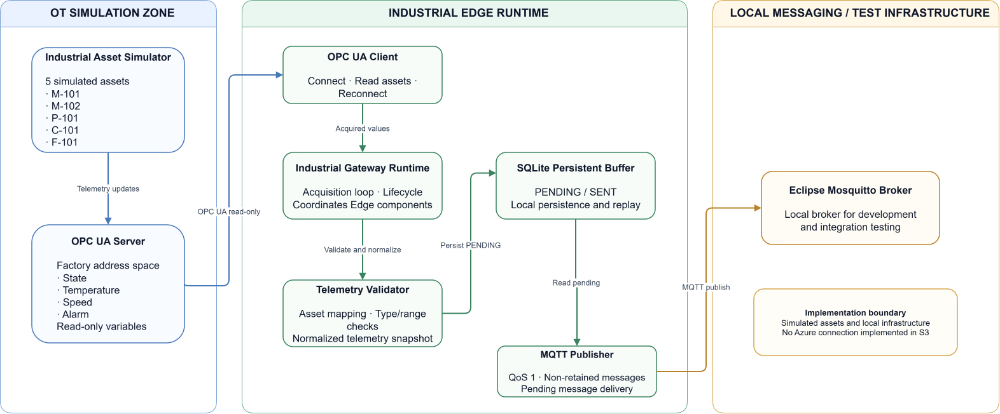
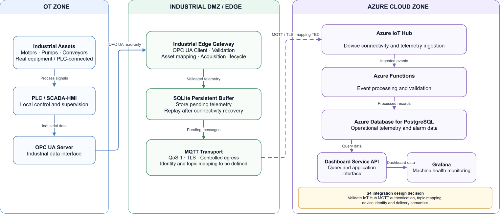

# Industrial Cloud Architecture Platform

## Overview

An industrial IoT reference implementation demonstrating secure OT-to-cloud integration for industrial asset monitoring.

The platform focuses on industrial protocols, Edge computing, telemetry processing, local data persistence, and controlled communication between industrial environments and cloud platforms.

The implementation builds on existing cloud architecture patterns and adapts them to industrial requirements.

## Business Use Case

**Smart Manufacturing Plant: Machine Health Monitoring**

The platform simulates industrial assets, collects operational telemetry, validates measurements, and prepares machine-health data for cloud-based monitoring.

| Asset ID | Industrial Asset |
| --- | --- |
| M-101 / M-102 | Electric motors |
| P-101 | Pump |
| C-101 | Conveyor |
| F-101 | Fan |

## Architecture

### Current Implementation



### Target Architecture



The current diagram represents the implemented and tested S0-S3 scope. The target diagram represents the planned OT-to-cloud architecture. Azure connectivity details, including IoT Hub MQTT authentication and topic mapping, remain an S4 design decision.


## Architecture Principles

| Principle | Implementation |
| --- | --- |
| OT autonomy | Local industrial control remains independent of cloud connectivity |
| Read-only acquisition | OPC UA is used for telemetry acquisition, without a cloud-to-PLC control path |
| Local resilience | SQLite buffers telemetry during broker interruptions |
| Message delivery | MQTT QoS 1 provides at-least-once delivery |
| Duplicate handling | Cloud-side idempotency and deduplication are required |
| Separation of concerns | Edge acquisition and cloud processing remain independent |

## Implemented Capabilities

### Industrial Simulator and OPC UA

| Capability | Description |
| --- | --- |
| Asset simulation | Five simulated industrial assets |
| OPC UA address space | State, temperature, speed, and alarm variables |
| Read-only access | Verified through an OPC UA client |
| Telemetry updates | Periodic updates generated by the simulator |

### Industrial Edge Gateway

| Component | Responsibility |
| --- | --- |
| OPC UA Client | Connects to the industrial OPC UA server and reads asset data |
| Asset Registry | Maps asset identifiers to their industrial types |
| Telemetry Validator | Validates and normalizes acquired measurements |
| SQLite Buffer | Persists pending telemetry locally |
| MQTT Publisher | Publishes telemetry using QoS 1 |
| Gateway Runtime | Coordinates acquisition, persistence, publication, and shutdown |

### Resilience and Lifecycle

| Capability | Behavior |
| --- | --- |
| OPC UA reconnection | Attempts to restore the connection after acquisition failures |
| MQTT reconnection | Automatically reconnects after broker interruptions |
| Message recovery | Publishes pending messages after broker availability returns |
| Controlled shutdown | Stops the Gateway before closing the OPC UA server |
| Persistent buffering | Retains pending messages in SQLite across interruptions |

## Testing and Quality

| Validation | Result |
| --- | ---: |
| Automated tests | 63 passed |
| Subtests | 17 passed |
| Overall code coverage | 91% |
| Black | Passed |
| isort | Passed |
| Flake8 | Passed |
| OPC UA integration | Passed |
| Gateway-to-MQTT integration | Passed |

Manual checks additionally validate MQTT connectivity, broker interruption, and message recovery.

## Project Status

| Phase | Description | Status |
| --- | --- | --- |
| S0 | Project initialization | Complete |
| S1 | Architecture definition and gap review | Complete |
| S2 | Industrial asset simulator and OPC UA server | Complete |
| S3 | Industrial Edge Gateway and local buffering | Complete |
| S4 | Cloud ingestion and machine-health monitoring | Planned |
| S5 | Industrial security hardening and observability | Planned |
| S6 | Landing Zone integration and portfolio documentation | Planned |

## Technology Stack

### Implemented

| Area | Technology |
| --- | --- |
| Programming | Python 3.11 |
| Industrial communication | OPC UA (`asyncua`) |
| Messaging | MQTT (`paho-mqtt`) |
| MQTT Broker | Eclipse Mosquitto |
| Local persistence | SQLite (`aiosqlite`) |
| Testing | Pytest |
| Code formatting | Black |
| Import sorting | isort |
| Static analysis | Flake8 |

### Planned

| Area | Technology |
| --- | --- |
| Cloud platform | Microsoft Azure |
| IoT ingestion | Azure IoT Hub |
| Event processing | Azure Functions |
| Operational database | Azure Database for PostgreSQL |
| Containerization | Docker |
| Infrastructure as Code | Terraform |
| CI/CD | GitHub Actions |
| Visualization | Grafana |
| Monitoring | Azure Monitor / Application Insights |

## Local Development

### Prerequisites

- Python 3.11
- Eclipse Mosquitto MQTT Broker
- Windows PowerShell

### Installation

Create and activate a virtual environment:

```powershell
py -3.11 -m venv .venv
.\.venv\Scripts\Activate.ps1
```

Install dependencies:

```powershell
pip install -r requirements-dev.txt
```

### Environment Management

```powershell
.\scripts\dev-environment.ps1 start
.\scripts\dev-environment.ps1 status
.\scripts\dev-environment.ps1 stop
```

### Quality Checks

```powershell
.\scripts\quality-check.ps1
```

### Tests with Coverage

```powershell
.\.venv\Scripts\python.exe -m pytest tests/ -v `
    --cov=edge.industrial_gateway `
    --cov=simulator.industrial_assets `
    --cov-report=term-missing `
    --cov-report=html
```

## Reuse Strategy

| Reference Project | Reusable Capabilities |
| --- | --- |
| [EV Fleet Monitoring Platform](https://github.com/IbNdah/ev-fleet-monitoring-platform) | Cloud ingestion, telemetry processing, monitoring, and CI/CD patterns |
| [Azure Enterprise Cloud Foundation](https://github.com/IbNdah/azure-enterprise-cloud-foundation) | Cloud governance and Landing Zone architecture |

The objective is to reuse established cloud capabilities while focusing implementation effort on industrial-specific requirements.

## Scope and Deployment Status

This repository documents an evolving industrial reference implementation.

The current Edge implementation is validated using simulated industrial assets and local infrastructure. Cloud integration and production-grade security hardening remain future development activities.

The platform is not certified for production OT deployment and does not control real industrial equipment.
