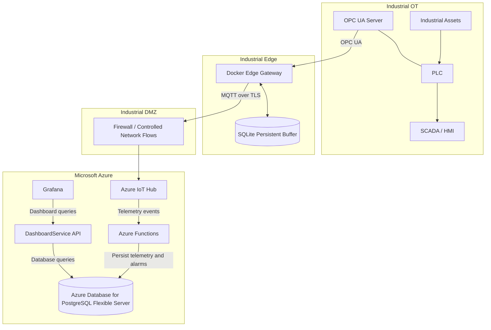

# High-Level Architecture

**Status:** Draft — S1
**Version:** 0.1.0

## 1. Purpose

Describe the end-to-end architecture of the Industrial Asset Monitoring Platform, from industrial telemetry acquisition to cloud processing and visualization.

## 2. Architecture Overview

The diagram is logical. Physical network placement, routing, DNS, and firewall rules must be validated during implementation.

## 3. Component Responsibilities

| Component | Responsibility |
|---|---|
| Industrial assets and PLCs | Represent equipment and local control |
| SCADA / HMI | Local supervision and operator visibility |
| OPC UA Server | Expose industrial measurements to authorized clients |
| Edge Gateway | Acquire, validate, normalize, buffer, and forward telemetry |
| SQLite | Persist queued messages during connectivity outages |
| Industrial DMZ / firewall | Enforce permitted communication paths |
| Azure IoT Hub | Authenticate the gateway and receive telemetry |
| Azure Functions | Validate and process messages, detect threshold violations, and persist results |
| PostgreSQL Flexible Server | Store factories, assets, telemetry, and alarms |
| DashboardService API | Provide monitoring data to the visualization layer |
| Grafana | Display asset status, telemetry trends, and alarms |
| Terraform and GitHub Actions | Provision infrastructure and automate quality checks |
| Azure Monitor / Application Insights | Collect application telemetry and operational diagnostics |

## 4. Main Data Flow

| Step | Flow | Description |
|---|---|---|
| 1 | Asset → OPC UA Server | Measurements are generated by simulated industrial equipment |
| 2 | OPC UA Server → Edge Gateway | The gateway reads and validates source measurements |
| 3 | Edge Gateway → SQLite | Messages are persisted before transmission and retained until MQTT delivery is acknowledged. |
| 4 | Edge Gateway → IoT Hub | Telemetry is sent over authenticated MQTT/TLS |
| 5 | IoT Hub → Azure Functions | Incoming messages are routed for processing |
| 6 | Azure Functions → PostgreSQL | Valid telemetry and resulting alarms are persisted |
| 7 | Grafana → DashboardService API → PostgreSQL | Monitoring data is queried and displayed |

The API's access to PostgreSQL must follow the selected hosting and network design. Grafana should access the API rather than connect directly to the database.

## 5. Resilience and Processing

| Situation | Expected behavior |
|---|---|
| Cloud connectivity lost | Local industrial control continues; Edge messages are buffered |
| Edge Gateway restarted | Persisted messages remain available in SQLite |
| Connectivity restored | Queued messages are replayed |
| Duplicate message delivered | Processing uses a stable message ID to prevent duplicate business records |
| Invalid telemetry received | The message is rejected or quarantined and the error is recorded |
| Threshold exceeded | An alarm is generated and persisted |
| Cloud processing unavailable | Local control remains independent; cloud processing resumes when service is restored |

The initial delivery model is at-least-once. Exactly-once transport is not assumed.

## 6. Data Model

| Entity | Purpose |
|---|---|
| `factories` | Identify industrial sites |
| `assets` | Describe monitored equipment and its factory |
| `telemetry` | Store timestamped measurements and message IDs |
| `alarms` | Store threshold violations and their status |

The initial implementation uses PostgreSQL. A dedicated time-series database or separate analytical platform will be considered only if measured requirements justify it.

## 7. Security Boundaries

- OT control remains local.
- There is no direct cloud-to-PLC control path.
- Edge-to-cloud communication uses authenticated TLS.
- Network flows are restricted across the OT, DMZ, and cloud boundaries.
- PostgreSQL is not exposed directly to the public Internet.
- Application identities receive only the access required for their roles.

Detailed controls are documented in `security-architecture.md`.

## 8. Deployment and Operations

| Area | Initial approach |
|---|---|
| Edge packaging | Docker |
| Local persistence | SQLite |
| Cloud infrastructure | Terraform |
| Cloud processing and API | Azure Functions, including the DashboardService API |
| Database | Azure Database for PostgreSQL Flexible Server |
| CI/CD | GitHub Actions |
| Monitoring | Azure Monitor and Application Insights |
| Visualization | Grafana |

The Azure IoT Hub built-in endpoint is Event Hubs-compatible. A separate Event Hubs namespace is not part of the initial design.

## 9. Key Validation Items

| Item | Required validation |
|---|---|
| IoT Hub ingestion | Confirm identity, routing, and Function trigger configuration |
| PostgreSQL connectivity | Confirm private networking, DNS, authentication, and TLS |
| Edge buffering | Test persistence, queue limits, replay, and duplicate handling |
| Grafana integration | Confirm API authentication and network reachability |
| Foundation integration | Verify that existing Terraform modules and outputs fit the workload |

## 10. Related Documents

- `context.md` — project purpose and scope.
- `ot-architecture.md` — industrial environment and Edge behavior.
- `security-architecture.md` — security controls.
- `gap-analysis.md` — reuse and implementation gaps.
- `requirements.md` — verification requirements.
- `technology-mapping.md` — Azure service mapping.
- `../adr/` — architecture decisions.
